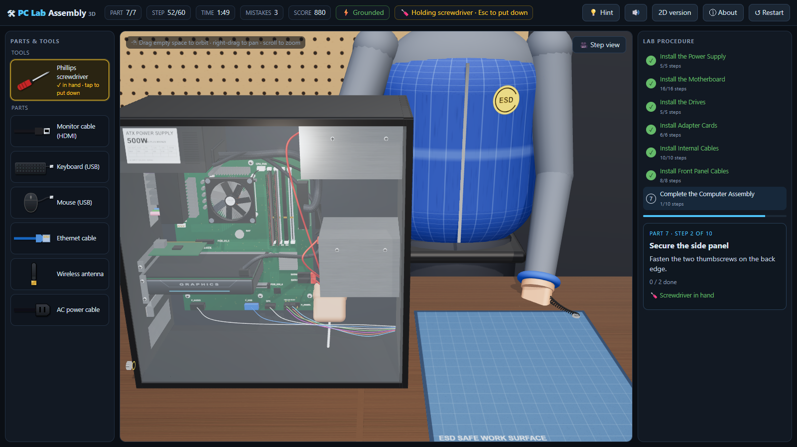
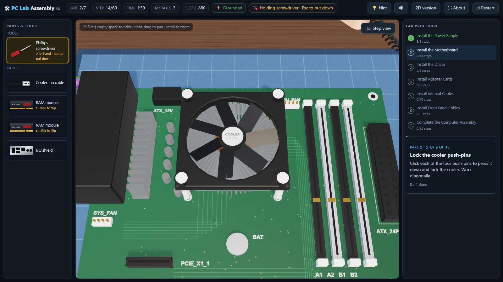
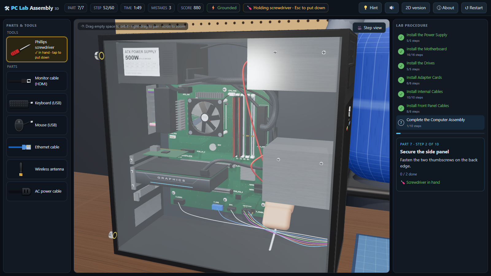
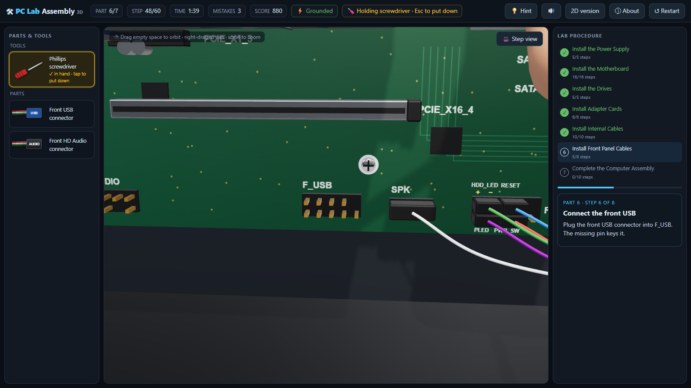
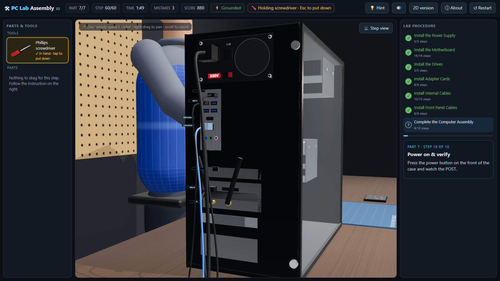

# 🛠 PC Lab Assembly

**A browser-based 3D simulator for practising PC assembly step by step, before you touch real hardware.**

   



> 🎓 **For educational purposes only.** Not affiliated with Cisco or any hardware vendor. See [DISCLAIMER.md](DISCLAIMER.md).

---

## What it is

PC Lab Assembly turns a typical "build a PC" lab into an interactive 3D workbench. You assemble a desktop computer in 7 parts and 60 steps:

1. **Install the power supply.** Remove the side panel, mount and screw in the PSU, and set the voltage selector for your country.
2. **Install the motherboard.** Put on an ESD vest and wrist strap. Install the CPU (match Pin 1), thermal paste, cooler and RAM on the antistatic mat, then fit the standoffs and I/O shield, and mount the board.
3. **Install the drives.** Hard disk drive in a 3.5" bay, optical drive in a 5.25" bay.
4. **Install adapter cards.** Wired NIC, wireless NIC and video card, each in a compatible PCIe slot.
5. **Install internal cables.** 24-pin, CPU power, SATA power and data, and PCIe power.
6. **Install front-panel cables.** Power and reset switches, LEDs with the correct polarity, speaker, USB and audio.
7. **Complete the assembly.** Side panel, monitor, keyboard, mouse, network, antenna and power. Then press the power button and watch the POST screen.

It runs entirely in the browser, with no install, account or server.

### Laptop Lab (`laptop.html`)

A second 3D lab where you assemble a laptop in 7 parts and 39 steps. You prepare the workspace, install the system board and its ribbon cables, fit the heat pipe and fan, and add SO-DIMM memory and an M.2 SSD. Then you install the M.2 Wi-Fi card, antennas and speakers, connect the battery last, close the laptop up, turn it over and power it on. It catches laptop-specific mistakes:

- a ribbon cable inserted with its contacts facing up, or into the wrong ZIF connector
- heat-sink screws tightened out of their numbered order
- an SO-DIMM with its notch the wrong way round
- an SSD in the E-key Wi-Fi slot, or the Wi-Fi card in the M-key SSD slot
- swapped MAIN/AUX antenna leads
- fan, speaker or battery cables on the wrong header
- the charger plugged into a data-only USB-C port

### Phone Lab (`phone.html`) and Tablet Lab (`tablet.html`)

Two more 3D labs, 6 parts and 28 steps each. You fit the logic board, cameras, charging port and speakers, lay the battery on new adhesive strips, then connect the display (phone) or the LCD and front-glass digitizer (tablet) to the board with press-fit connectors. You connect the battery last, fit the connector shield, close the display like a book and run the self-test. They catch:

- a flex cable pressed onto the wrong board connector
- the battery fitted before its adhesive strips
- a 3.6 mm screw where a 1.2 mm screw belongs ("long screw damage")
- an upside-down SIM tray (phone)

## Features

- **Realistic 3D bench** built with three.js: a tower case with a glass side panel, a motherboard with readable silkscreen labels, braided cables routed through grommets, lighting, reflections and shadows.
- **A technician at the bench** who wears the ESD vest and wrist strap and reaches for whatever you're working on.
- **Real tools and real mistakes.** You must pick up the screwdriver before turning screws. The game catches the classic errors:
  - handling the CPU or RAM before grounding yourself
  - misaligned Pin 1 or a backwards RAM module
  - the cooler fitted before thermal paste
  - the CPU fan on the wrong header
  - a video card in an x1 slot, or a card fitted with its slot cover still in place
  - power and data connectors swapped
  - LED leads with reversed polarity
  - the monitor plugged into onboard video when a video card is installed
  - the wrong PSU voltage for the region
- **Every mistake is explained.** The feedback says *why* it's wrong in real life (bent pins, overheating, a PSU that won't power on), not just "incorrect".
- **Practice and Challenge modes.** Practice highlights every target. Challenge has scoring, a timer, paid hints and a saved best score.
- **A 2D version** (`2d/`) that works offline on low-end machines.

| CPU and cooler on the mat | Inside the case | Front-panel header | Rear I/O |
|---|---|---|---|
|  |  |  |  |

## Real-world impact

Building a PC is a core skill in IT courses, help-desk roles and hardware certifications. It's also where beginners make costly, irreversible mistakes. This project helps in a few concrete ways:

- **Fewer damaged parts.** Bent CPU socket pins, static-damaged RAM and reversed connectors are common first-timer mistakes, and many can't be undone. Making those mistakes in a simulator, with an explanation, is free.
- **Safety habits before muscle memory.** The game won't let you skip grounding, insists on the right tool, and teaches you to check the PSU voltage. Rehearsed in the right order, these become habits you carry into a real lab.
- **Access without a lab.** Not every student has spare hardware, lab time or a nearby workshop. A free browser simulator lets anyone rehearse the procedure at home, on a school laptop, or before a practical session, so lab time goes to hands-on practice rather than reading instructions.
- **Lower costs for schools and trainers.** Instructors can use it as pre-lab preparation or a revision tool, which means fewer worn-out training parts and more productive supervised sessions.
- **Confidence for beginners.** Knowing *where* each connector goes and *why* before opening a real case makes a first build far less intimidating.
- **Reading real hardware.** Labels such as `CPU_FAN`, `ATX_12V`, `F_PANEL` and the `+`/`−` LED pins look and behave like the real thing, so the skill transfers to actual motherboards.

### Limitations, to be honest

- It's a **simplified** model. Real sockets, coolers, cases and header layouts vary by manufacturer, so always follow the manuals for your actual parts.
- It teaches **procedure and decision-making**, not the physical feel of seating a CPU or clicking in RAM. It complements supervised hands-on practice; it doesn't replace it.
- The hardware is an older-style "lab PC" (LGA socket, SATA optical drive, PCIe NICs). Modern builds add things like M.2 SSDs and modular PSUs.

## Run it

| Version | Open | Needs internet? |
|---|---|---|
| 3D (main) | `index.html` | Yes, it loads three.js from the jsDelivr CDN |
| Laptop Lab (3D) | `laptop.html` | Yes, it loads three.js from the jsDelivr CDN |
| Phone Lab (3D) | `phone.html` | Yes, it loads three.js from the jsDelivr CDN |
| Tablet Lab (3D) | `tablet.html` | Yes, it loads three.js from the jsDelivr CDN |
| 2D (desktop PC only) | `2d/index.html` | No |

Clone or download the repo and open the file in Chrome, Edge or Firefox. No build step, no server, no dependencies to install.

```bash
git clone https://github.com/Htet-Myark/pc-lab-assembly.git
cd pc-lab-assembly
# then open index.html in your browser
```

## How to play

- **Drag** parts and cables from the left tray onto the bench. Valid spots light up green.
- **Click** levers, slot covers, switches and screws when a step asks for it.
- **Tap the screwdriver** (Tools tray, or on the desk) before any screw. Press **Esc** to put it down.
- **Click a part in the tray** to rotate or flip it. Pin 1, RAM notches and LED polarity matter.
- **Camera:** drag to orbit, right-drag to pan, scroll to zoom. Press **V** to snap back to the step view, and **H** for a hint (Challenge mode).

## Project structure

```
├── index.html              3D game (entry point)
├── laptop.html             3D Laptop Lab (entry point)
├── phone.html, tablet.html 3D Phone and Tablet Labs (entry points; set window.DEVICE)
├── guides/                 written step-by-step guides (PC, laptop)
├── 2d/index.html           2D game (offline)
├── assets/
│   ├── css/                app.css (3D), app-2d.css (2D)
│   ├── js/3d/              loaded in order:
│   │   ├── common.js       DOM helpers and SVG gradients (shared with the laptop lab)
│   │   ├── items.js        parts list, tray icons
│   │   ├── engine.js       renderer, lights, procedural textures, materials, helpers, tweens
│   │   ├── world.js        desk, case, PSU, motherboard, cards, drives, cables, screws
│   │   ├── technician.js   technician figure, ESD vest, wrist strap, two-bone arm IK
│   │   ├── game.js         camera views, the 60 steps, rules, drag/drop & click handling, hints
│   │   ├── ui.js           tray, step card, sounds, POST screen, render loop
│   │   └── main.js         builds the scene and starts the loop
│   ├── js/lab/             core.js (step flow, drag & drop, hints) and ui.js (tray, step card, results, loop),
│   │                       shared by the laptop, phone and tablet labs
│   ├── js/laptop/          items.js, world.js (laptop model), game.js (39 steps), main.js
│   ├── js/mobile/          items.js, world.js, game.js, main.js: one codebase for the phone and tablet labs
│   │                       (all of these also reuse 3d/common, engine, world (desk, screws) and technician)
│   └── js/2d/              items.js, scene.js, game.js, ui.js
├── docs/screenshots/
├── LICENSE
├── DISCLAIMER.md
└── README.md
```

All textures (wood, PCB, labels, mesh, braided sleeving) are drawn procedurally at runtime, so the repo contains no third-party art. The 3D scripts are plain files that share one scope. A small inline loader in `index.html` imports three.js and then loads them in order. This keeps the game working when it's opened straight from disk, where browsers block separate module files.

## Disclaimer

Educational use only. This project is not affiliated with, endorsed by, or sponsored by Cisco Systems, Inc., the Cisco Networking Academy, or any hardware manufacturer. Hardware names in the game are fictional. When working on real computers, disconnect power, use ESD protection, and follow the manufacturer's instructions. Full text: [DISCLAIMER.md](DISCLAIMER.md).

## License

[MIT](LICENSE) © 2026 Htet Myark Aung. three.js is © the three.js authors (MIT).
